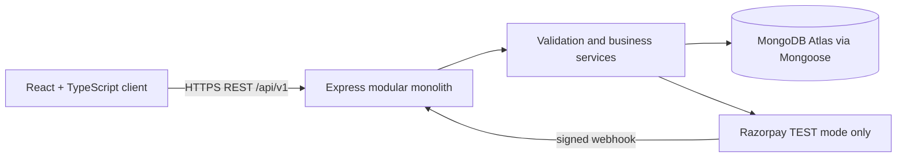
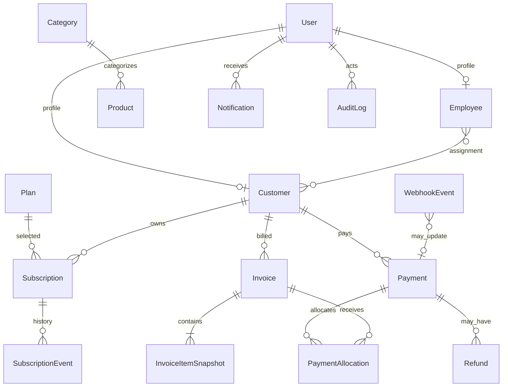

# Architecture

## Product baseline

- Product: Virtual Raksha Kavach business management system
- Platform: responsive web application only; Android is out of scope
- Users: Admin, Employee, Customer
- UI language: English
- Currency: INR, displayed as ₹; store monetary amounts as integer paise
- Business timezone: Asia/Kolkata
- Brand tokens: black `#111111`, red `#C8102E`, white `#FFFFFF`, soft neutral background `#F5F5F6`;
  success `#16845B`, warning `#B86A12`, danger `#B42318` remain semantic status colors. The supplied
  brand logo is `client/public/virtuallogo.jpeg`.

## System shape

Use a modular monolith: one TypeScript Express REST API, split by business capability, and one
React/TypeScript client. The client calls the versioned API. Local Vite development proxies `/api`
to Express; production hosting may route the same path to the API. MongoDB Atlas and Mongoose
provide persistence; local development can omit the URI for API liveness and isolated tests.

## Repository boundaries

- `client/src/app`: application providers and router
- `client/src/components`: reusable presentation and layout components
- `client/src/features`: feature-owned screens, API calls, hooks, schemas, and tests
- `client/src/lib`: shared client utilities and API primitives
- `server/src/config`: validated environment and infrastructure configuration
- `server/src/middleware`: authentication, authorization, validation, and error handling
- `server/src/modules`: routes, controllers, services, schemas, and models grouped by capability
- `server/src/jobs`: scheduled subscription and reminder work
- `server/src/utils`: cross-module server helpers
- `docs`: architecture, API, decision log, and delivery plan

Controllers translate HTTP to service calls. Services own business rules and transactional
operations. Mongoose models own persistence shape and indexes. Frontend feature modules call the
API through shared transport utilities; UI visibility is never a security control.

## Planned data relationships

Relationships are initial schema definitions and indexes, not finalized business workflows. Important invariants:

- `User` holds login identity and status; Customer and Employee hold role-specific profiles.
- Catalogue products use PHYSICAL/SERVICE types, INR integer-paise purchase/selling prices,
  non-negative physical stock, optional HTTPS image URLs, and active/inactive/archived states.
- Product and category changes are recorded in audit history. Invoice line item name/price fields
  are snapshots; catalogue edits never rewrite existing invoices.
- Customer-to-employee assignment supports multiple employees and one primary employee.
- Invoice items retain immutable snapshots so later catalogue edits do not rewrite history.
- Payment allocation is a separate record: one payment may cover multiple invoices, and an invoice
  may receive multiple payments. Unallocated excess remains customer advance.
- Subscription periods and renewal/cancellation events remain historical records.
- Audit and webhook-event IDs are unique where required to support traceability and deduplication.

## Financial and subscription invariants

- Store amounts as integer paise; do not use binary floating-point arithmetic for money.
- Payment balance is derived from invoices, allocations, credits, and approved refunds; a manually
  edited balance is not the source of truth.
- Default allocation is FIFO by oldest outstanding invoice. Admin/authorized employees can choose
  invoice allocations. Partial payments are supported.
- Successful payment records are not silently edited or deleted. Corrections use auditable reversal
  or refund entries. Refunds require admin approval.
- Invoice numbers use an atomic monthly counter in Asia/Kolkata. Invoice lines preserve name and
  unit-price snapshots; invoice totals are recalculated from current server catalogue values.
- Manual CASH, UPI, and bank-transfer payments use a unique idempotency key. Payment, allocation,
  stock, invoice-status, and audit mutations are committed together in a MongoDB transaction.
- Refund requests reserve both payment and invoice allocation capacity. Rejection releases the
  reservation; approval records a processed refund without mutating the original payment row.
- PDF invoices and receipts are generated from persisted snapshots and payment allocations.
- Payment creation and webhook processing must be idempotent. Frontend success indicators are not
  proof of payment; server-side provider verification is required.
- Renewal before expiry extends from the current expiry. Renewal after expiry starts from the new
  payment/activation date. Grace period is configurable. Cancellation does not automatically refund.
- GST/tax calculation supports future inclusive/exclusive pricing configuration, but actual rates,
  applicability, rules, and legally compliant invoice output remain blocked pending client/accountant
  confirmation. See the [Business Decision Log](business-decisions.md).

## Access and security boundaries

- Roles: Admin, Employee, Customer. Backend authorization checks role, explicit permission,
  customer ownership, and employee assignment for every protected record operation.
- Customer identity is derived from the authenticated principal, never an arbitrary request
  `customerId`.
- Authentication uses a short-lived JWT access cookie plus a rotating opaque refresh cookie. Both
  are HttpOnly, SameSite Strict, and Secure in production. Refresh secrets and one-time links are
  stored only as hashes. A server-validated HMAC-bound CSRF token is required for cookie-authenticated
  state changes. Sessions expire and are revocable server-side.
- Admin creates Employee/Customer accounts and delivers approved one-time email invitations. The
  approved link expires after 24 hours; invitation resend limits remain pending. Email is the primary
  login identifier and phone is optional. OTP may be added later.
- Cookie-based state changes require CSRF protection; production requires HTTPS, strict CORS,
  security headers, input validation, rate limits, secret management, and least-privilege database
  access.
- No credentials or secrets belong in frontend `VITE_` configuration. Development uses no real
  customer data.

## API and integrations

- REST base: `/api/v1`; current foundation endpoints: `GET /api/v1/health` (process liveness) and
  `GET /api/v1/health/ready` (database readiness).
- Module groups: auth/users, customers, employees, products/services/categories, plans,
  subscriptions, invoices, payments/allocations/refunds, ledger, notifications, reports, settings,
  audit logs, and payment webhooks.
- Razorpay is planned in sandbox/test mode first. Live credentials and activation require client
  approval. Email and in-app reminders are initial channels; SMS/WhatsApp depend on later provider
  and consent decisions.
- Customer records are invite-provisioned, soft-archived, employee-assignment scoped, and exposed to
  customers through the authenticated profile only. Customer email changes require a 24-hour
  confirmation link to the proposed address and revoke existing sessions after confirmation.
- Full route scope is in [API Specification](api-specification.md); unapproved request payloads and
  tax behavior are intentionally not invented here.

## Quality and deployment

- Frontend: Vitest and React Testing Library for components and user flows.
- Backend: Jest or Vitest with Supertest for APIs and business rules; use an isolated test database
  when persistence is introduced.
- Cover role/ownership boundaries, FIFO/partial/advance allocations, idempotency, subscription date
  boundaries, webhook verification, refund approvals, reconciliation, report totals, and notification
  deduplication/delivery retries.
- Keep local, staging/demo, and production configuration separate. Free-tier services may have
  limits and are for public demonstration only unless suitability is reviewed.
- Production readiness requires TLS, secret configuration, monitoring, automated backups and
  restore validation, migration/reconciliation procedure, rollback plan, and client sign-off.
- No live payment activation or public production deployment without explicit client approval.

## Backend foundation details

- Express middleware order is request logging, Helmet headers, allowlisted credentialed CORS, bounded
  JSON/urlencoded parsing, API rate limiting, versioned routers, not-found handling, then centralized
  errors.
- Mongoose connects before the listener when `MONGODB_URI` is configured. It may be omitted in local
  development so liveness can be checked; readiness returns `503` until MongoDB is connected. It is
  required in production.
- Schema indexes are declared with each model. Development enables automatic index creation;
  production disables auto-indexing so index changes can be reviewed and applied deliberately.
- See [Database and Environment Guide](database-and-environment.md) for local setup, collections,
  index notes, API conventions, and development seed safeguards.
